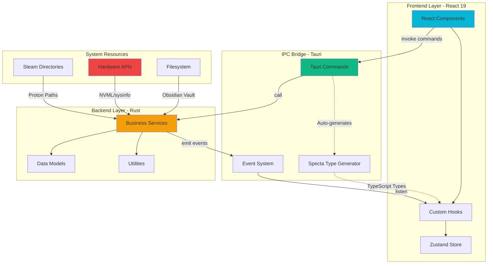
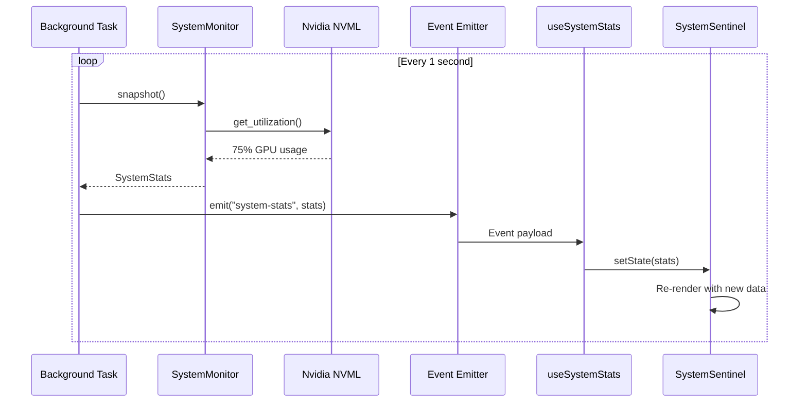
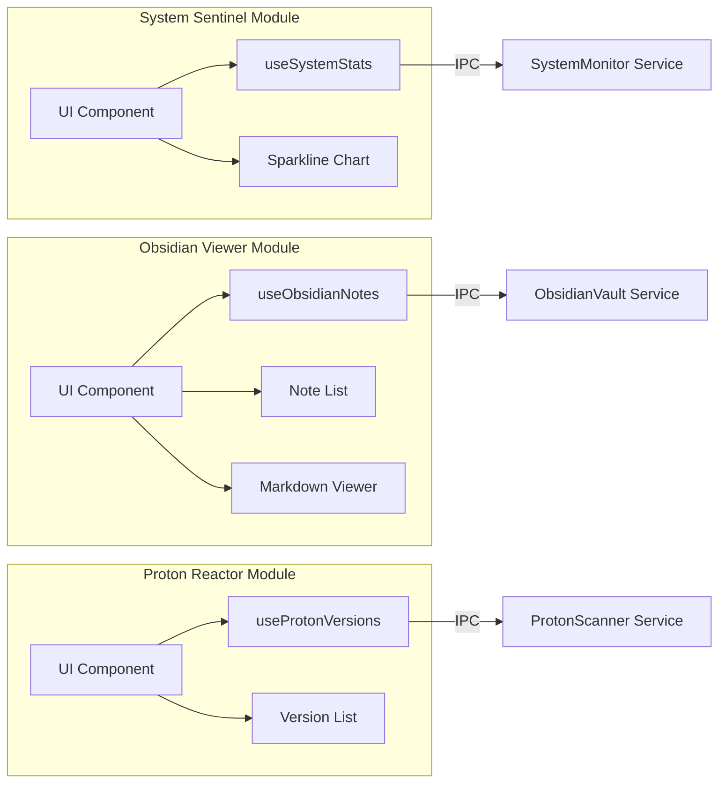
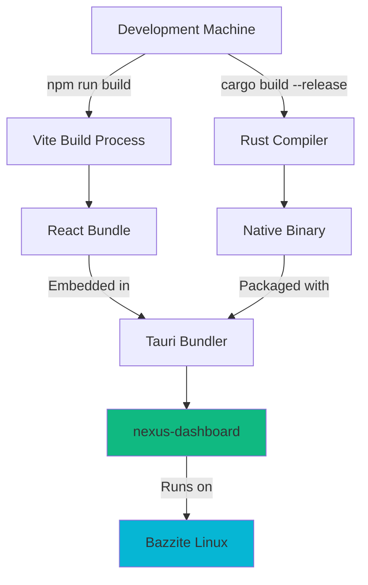
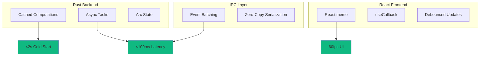

# Nexus Dashboard - System Architecture



## Data Flow: System Monitoring



## Module Architecture



## Type Safety Flow

```mermaid
graph TD
    A[Define Rust Type] -->|#[derive Type]| B[Rust Struct]
    B --> C[Tauri Command]
    C -->|cargo build| D[Specta Generator]
    D -->|Generates| E[TypeScript Interface]
    E --> F[React Component]
    F -->|invoke| C
    C -->|Type-safe return| F
    
    style A fill:#f59e0b
    style E fill:#06b6d4
    style D fill:#10b981
```

## Deployment Architecture



## File System Access Patterns

```mermaid
graph LR
    App[Nexus Dashboard]
    
    App -->|Read| Vault[Obsidian Vault<br/>/var/home/.../fs0ciety]
    App -->|Scan| Steam1[~/.steam/<br/>compatibilitytools.d]
    App -->|Scan| Steam2[~/.local/share/Steam/<br/>compatibilitytools.d]
    App -->|Monitor| NVML[/dev/nvidia0<br/>via NVML]
    App -->|Read| Sysinfo[/proc/stat<br/>/sys/class/thermal]
    
    style Vault fill:#f59e0b
    style NVML fill:#ef4444
    style Sysinfo fill:#10b981
```

## Performance Optimization Strategy


